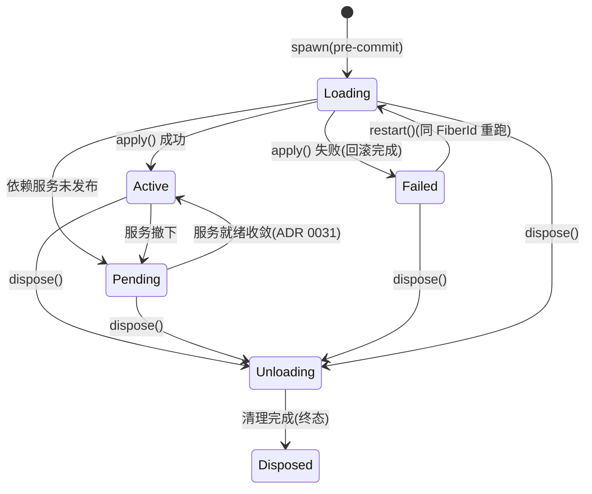
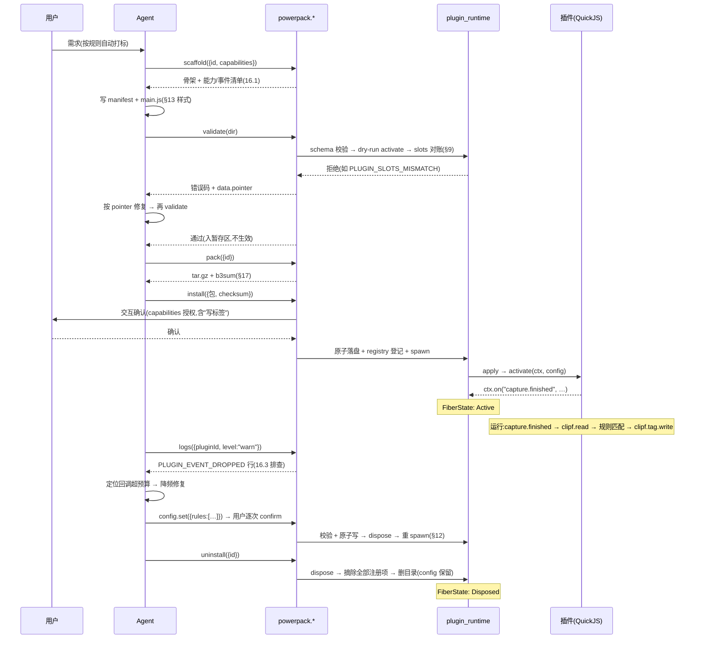

# 设计:插件接口契约(agent-plugin-runtime)

> 状态:draft。Phase 1 闸门通过后随实现冻结,ctx 方法集与 manifest schema 进 golden 测试。
> 原则:接口先定、场景后置;manifest 是安装时审查的合同,runtime register 是运行时唯一事实,二者对账。

## 1. 包形态与落盘

```
~/Library/Application Support/ClipForge/plugins/<id>/
├── power-pack.json      # manifest(合同,安装时审查)
├── main.js              # 入口(ESM,named export)
├── templates/*.md       # 可选,提示词模板资源
└── README.md            # 可选
```

- 单包单目录,ESM,无打包器要求(QuickJS 原生 module 加载)。
- 暂存区:`plugins/.staging/<id>/`(validate 通过、用户确认后才原子改名入库,复用 settings_service 原子写模式)。
- 状态注册表:`plugins/registry.json`(借鉴 pi `omp-plugins.lock.json`)——`<id> → { enabled, version, installedAt }`,启用/停用状态与已装版本的唯一事实;config.json 只管用户配置,不混运行状态。registry 写入与目录改名非跨文件事务,崩溃窗口(注册表落后/领先于磁盘)由 `powerpack.doctor` 自检修复。

## 2. manifest(power-pack.json)

```json
{
  "api": 1,
  "id": "com.example.quick-tag",
  "name": "快速标签",
  "version": "0.1.0",
  "entry": "main.js",
  "capabilities": {
    "clipf": ["search", "read"],
    "events": ["clip.updated", "capture.finished"]
  },
  "slots": {
    "tools": [
      { "name": "tag-stats", "description": "按标签统计剪贴板历史" }
    ],
    "ui": [
      { "surface": "quick-panel-button", "title": "标签统计", "icon": "tags" }
    ],
    "templates": [
      { "name": "weekly-summary" }
    ]
  },
  "memoryLimit": "8MB",
  "toolTimeoutMs": 5000,
  "eventBudgetMs": 100,
  "config": {
    "type": "object",
    "properties": {
      "defaultTag": { "type": "string", "default": "未分类" }
    },
    "default": { "defaultTag": "未分类" }
  }
}
```

| 字段 | 必填 | 校验 |
|---|---|---|
| `api` | 是 | 契约版本,当前 `1`;宿主支持 N 与 N-1 |
| `id` | 是 | 反向 DNS,全局唯一,装包即占位 |
| `name`/`version` | 是 | 展示名 / semver |
| `entry` | 否 | 默认 `main.js` |
| `capabilities.clipf` | 否 | 子集 ⊆ 已发布能力清单(§5),越界=validate 拒绝 |
| `capabilities.events` | 否 | 子集 ⊆ 已发布事件清单(§6) |
| `slots` | 否 | 安装审查索引:name 级对账,细节以 runtime register 为准 |
| `config` | 否 | JSON Schema(draft-07 子集:object/string/number/integer/boolean/enum/array),顶层属性必须带 `default`(数组 items 内属性用 `required` 约束);宿主侧校验(§12) |
| `memoryLimit` | 否 | 默认 `8MB`,上限 `32MB`(超出=validate 拒绝) |
| `toolTimeoutMs` | 否 | 默认 5000,上限 30000 |
| `eventBudgetMs` | 否 | 默认 100,不可调高(热路径红线) |

## 3. 插件入口与生命周期

```js
// main.js —— ESM,生命周期钩子 = 两个 named export,没有更多
export function activate(ctx) {
  // 必须导出。同步执行:注册/订阅是纯声明,无 IO;一切经 ctx 注册的对象归本次 apply 世代所有
}

export async function deactivate(ctx) {
  // 可选导出。仅插件自有外部善后(v1 能力集下通常为空,世代清理已覆盖全部 ctx 注册项)
}
```

**生命周期映射(插件可见行为 ↔ cordis-rs 语义)**:

| 用户/宿主动作 | cordis 语义 | 插件侧发生什么 |
|---|---|---|
| 宿主启动 | registry enabled 插件排程 spawn:首帧就绪/空闲回调之后,并发上限 4,每插件记 spawn 耗时日志 | 主线程只付线程创建成本(µs 级);Runtime init/模块 eval/activate 全在插件自有线程,不阻塞 app-ready |
| 安装并启用 | `Context::spawn` → `apply()` | 新建 Runtime,加载模块,调 `activate(ctx)` |
| 停用 | `FiberHandle::dispose()` | 先调 `deactivate`(宽限 2s,超时孤儿化不阻塞清理),再世代清理回收全部注册项,销毁 Runtime |
| 重新启用 | dispose → 重新 spawn | 全新 Runtime,状态归零(不做热重启) |
| 升级到新版本 | dispose → 新包 spawn | 同上;JS 无跨版本残留 |
| `activate` 抛异常 | `apply()` 失败 → Fiber 收敛 `Failed` | 插件标记失败并停靠,**不自动重试**;`powerpack.logs` 可见错误,用户重新启用=显式 restart |
| 内存超限(三层链命中) | Fiber 收敛 `Failed` → 宿主 `dispose()` | Runtime 强制回收,插件停 `failed`,不自动重启;用户显式重新启用=新 spawn |
| 所需能力对象暂不可用 | Service 未发布 → `Pending` | `activate` 尚不执行,宿主等待收敛(能力随宿主域起停) |

- 无手动 unregister;无 onload/onunload 之外的隐藏钩子。事件回调与工具 handler 是唯一的另外两类"钩子",均在 `activate` 内注册。

**Fiber 状态机(cordis `FiberState` 六态,2026-10-10 源码核实;宿主插件状态面映射其上)**:



- **Failed 非终态**:可 `restart()`(同 FiberId,对已提交输入重跑 apply)或 `dispose()` 终结;重新 `spawn` = 新 FiberId 新身份。v1 宿主统一走 dispose→spawn;`restart` 语义 Phase 1 spike 记录备查。
- **dispose 无宽限参数**:cordis `dispose()` 是幂等终态直通车(并发调用合并到首个清理事务,已完成后再调直接成功);上表「停用」行的 deactivate 宽限 2s 由宿主侧实现——先等插件自有异步善后 drain(超时 2s)再调 `dispose()`。**Drop FiberHandle 不触发清理**(cordis 明示),宿主必须显式 dispose。
- **失败原因可观测**:`PluginFailure{kind: ReturnedError|Panic, diagnostic}` 经 spawn(InitialApply)/ready/restart/update 四条路径回宿主;panic 在 settle 边界被包含,不击穿宿主;无自动重试。

**插件模型(一种插件,不是 N 种插件)**:

- 插件只有一种:一个包 = 一个功能 = 一条 Fiber 一套生命周期(activate/deactivate)。**不存在"工具插件/事件插件/UI 插件"的分类**。
- 工具 / 事件 / UI 按钮 / 提示词模板是四种**注册类型**,同一插件在 `activate` 内任意组合(`ctx.register.*` 与 `ctx.on` 混用),dispose 时一并回收。
- manifest `slots` 只是"将要注册什么"的声明索引,可为空——纯事件+能力插件(如 §13 规则打标,`slots: {}`)。
- Phase 3 任务按 3.1/3.2/3.3 分条只是**实现切片**(每类注册类型各自打通),不是插件类型学。

| 插件 | 事件 | 能力调用 | 工具 | UI | 模板 |
|---|---|---|---|---|---|
| 规则自动打标(§13) | ✓ | ✓ | — | — | — |
| 快速标签(§2) | — | ✓ | ✓ | ✓ | ✓ |
| 全能型(合法) | ✓ | ✓ | ✓ | ✓ | ✓ |

**宿主插件状态面(设置页/powerpack.list 可见,映射 FiberState 六态)**:

| 宿主状态 | 触发 | FiberState 对应 | 用户动作 |
|---|---|---|---|
| `disabled` | 用户停用 | 无 Fiber(已 dispose) | 启用→spawn |
| `loading` | spawn 中 | Loading | — |
| `active` | 运行中 | Active | 停用/改配置 |
| `pending` | 等待宿主服务 | Pending | 停用 |
| `failed` | activate 抛异常/内存超限三层链/引擎崩溃 | Failed(非终态) | 重试(=重新启用)/停用 |
| `degraded` | 事件预算超限降级 | Active(插件级降级位,不换 Fiber,**工具仍可调**) | 停用 |
| `disposed` | 卸载 | Disposed | 重装=新身份 |

- `pending`/`degraded` 不算 `failed`:pending 是宿主侧等待(能力服务未发布),degraded 是运行期丢弃(队列清空后自动回升 active)。
- **状态语义单一化(进 golden)**:内存超限/引擎崩溃 → 一律 `failed`(Fiber dispose 后停靠,重启=显式 enable);`degraded` 仅指事件预算降级位(插件仍 Active、工具可调,队列清空自动回升)。状态面是单字符串不带原因字段,原因查日志(§14)。

## 4. ctx 全局对象(插件唯一可见面)

```js
ctx.clipf.search({ q, limit?, tag?, since? })   // 按声明存在
ctx.clipf.read({ id })
ctx.on("clip.updated", (envelope) => { ... })   // 仅已声明事件名生效
ctx.register.tool({ name, description, inputSchema, handler })
ctx.register.ui({ surface, title, icon?, order?, action })
ctx.register.template({ name, text, variables? })
ctx.log.debug|info|warn|error(msg, extra?)
```

- **能力按命名空间属性暴露**:manifest 未声明的分支整个不存在(`ctx.clipf` 上没有 `write`,插件连它存在都不知道),不做运行时拒绝、不产生错误回执。声明在 manifest,消费靠属性——声明与使用分离,和 cordis「InjectSpec 声明 → Service 属性解析」同构。
- `ctx` 之外无任何宿主注入:无 `fetch`、无定时器(没有 `setTimeout`;v1 纯事件+工具调用驱动,定时类能力未来 additive)、无 `require`/`import` 宿主模块、无文件系统。QuickJS 默认无 host function,我们也不注。
- `ctx.on` 收到未声明事件名:静默忽略(同"不可见"原则,不报错)。

**异步语义**:

| 位置 | 同步/异步 | 说明 |
|---|---|---|
| `activate` / `ctx.register.*` / `ctx.on` | 同步 | 纯声明,即刻返回,无 Promise |
| 能力调用(`ctx.clipf.*`) | 异步 Promise | Rust Future ↔ JS Promise(rquickjs executor 在 tokio 上泵 job queue),计入插件 toolTimeout 预算 |
| 工具 `handler` | async 函数 | 入参已过 schema 校验;宿主 `await` 带 `toolTimeoutMs` 超时,超时=本次调用报错返回,Runtime 不销毁 |
| 事件回调 | 可同步可 async | 宿主 `await` 带 `eventBudgetMs` 超时;超时=本次丢弃计数,Promise 不中断但结果弃用(JS 无法强杀,靠预算+队列丢弃兜底) |

- await 之外没有并发原语:无线程、无 Worker、无定时器;多请求并行=`Promise.all` 能力调用。
- **阶段门**(借鉴 pi `ExtensionRuntimeNotInitializedError`):`activate` 内调用 `ctx.clipf.*`(能力调用)→ 明确报错 `PLUGIN_ACTIVATE_READONLY`(activate 只做注册,能力调用只能在事件回调/工具 handler 内);`ctx.on`/`ctx.register.*` 在 activate 之外不可用。阶段用错=清晰报错,不是静默无效。
- **unhandled Promise rejection**:宿主经 `set_host_promise_rejection_tracker` 捕获并记 error 日志(Runtime/AsyncRuntime 均有该 API);不依赖 `idle()` 收错(其当前实现对 job 内异常只打印不传播)。

## 5. 首批能力对象(读+元数据写先行)

| 能力 | 签名 | 返回 |
|---|---|---|
| `clipf.search` | `({ q, limit?=20, tag?, since? })` | `{ items: [{ id, preview, bytes, contentType, capturedAt, tags[] }], total }`(不含正文;`bytes`=正文字节数,供插件预过滤) |
| `clipf.read` | `({ id, maxLen? })` | `{ id, content(≤maxLen), contentLength, truncated, contentType, metadata }`(过 L2 key redaction 管线) |
| `clipf.tag.write` | `({ id, tags[], source? })` | `{ ok, tags }`——**元数据写级** |

- 全部返回 Promise(Rust Future ↔ JS Promise,rquickjs 桥);调用计入该插件 toolTimeout 预算。
- **能力分级授权**:读=启用即可用;元数据写(打标)=安装时一次性授权(用户装包即知情),无逐次 confirm;内容写/删除/粘贴回写=逐次 confirm。分级边界写进 golden 用例。
- 新能力分支均为 additive,`api` 保持 1。
- **能力返回方向同受上限(与 memoryLimit 记账对齐)**:`clipf.read` 默认截断 256KB,显式 `maxLen` opt-in 上限 `min(memoryLimit/4, 2MB)`,超上限该次调用报 `PLUGIN_CAPABILITY_OUTPUT_OVERSIZE`(§14/§15);事件信封带 `bytes/payloadKind`(§6),插件先探大小再决定读不读。依据:宿主采集上限(文本默认 5MB/可调 100MB)大于 memoryLimit 硬顶(32MB),全文读取不是插件场景,批处理用 `maxLen` 分页。
- **二期能力**:`ai.invoke`——`({ prompt, system?, maxTokens? }) → { text, usage }`,走宿主 provider 层,模型白名单宿主控,插件不可指定 endpoint;就位后内置 AI 打标可整体外移(§13)。

## 6. 事件契约(对齐 agent-extension-seams 事件面)

| 事件名 | 载荷信封 |
|---|---|
| `capture.finished` | `{ v: 1, type, clipId, tsMs, bytes, payloadKind }` |
| `clip.updated` | `{ v: 1, type, clipId, tsMs, bytes, payloadKind }` |
| `clip.trashed` / `clip.restored` | `{ v: 1, type, clipId, tsMs, bytes, payloadKind }` |

- 信封 schema 以 agent-extension-seams 事件面为权威来源;本节字段 `{ v, type, clipId, tsMs, bytes, payloadKind }` 为 seams 落地前的前瞻草案,已明确需求侧(插件预过滤)要求 bytes/payloadKind,差异走 api 版本;事件名对齐 seams 已发布事件清单;插件侧载荷只读。
- 分发:有界队列(每插件 64),满载丢弃并计数;handler 超 `eventBudgetMs` 该插件降级(丢弃后续直至队列清空),绝不反压采集/面板热路径。**机制钉死(进实现验收)**:采集线程只做 `try_send` 到中央 dispatcher(或每插件有界 channel),丢弃计数走原子变量,日志异步——采集线程内不做序列化、不持锁。

## 7. 工具注册(动态口)

```js
ctx.register.tool({
  name: "tag-stats",                    // 实际暴露为 plugin.com.example.quick-tag.tag-stats
  description: "按标签统计剪贴板历史",
  inputSchema: { /* JSON Schema draft-07 */ },
  async handler(input) { return { byTag: { ... } }; }  // 返回值须 JSON 可序列化
});
```

- 前缀由宿主加,插件不可伪造;handler 入参已过 inputSchema 校验。
- 聚合:`tools/list` 拼接,条目带 `source: "plugin:<id>"`;**聚合只读宿主侧注册表快照**(activate 时与 runtime register 同源落入,dispose/register 递增版本计数器,供将来客户端缓存失效),绝不 round-trip 插件线程;单插件禁用=网关层摘除其命名空间。
- **前端通道(消费者对齐,additive)**:插件工具不只服务外部 MCP Agent——前端 pi Agent 经两个 additive Tauri 命令消费同一注册表快照:`list_plugin_tools()`(返回 name/description/inputSchema/来源标记)与 `invoke_plugin_tool(name, args)`(复用同一最终校验闸门与 toolTimeout 预算);pi 侧在 `clipForgeTools()`(src/agent/pi/tools.ts 现静态数组处)动态合并。两个面数据源同源,不出现第三套挂载机制。
- `powerpack.*`(scaffold/validate/pack/install/uninstall/list/logs/config.get/config.set/doctor)是宿主固有工具,不进插件命名空间;v1 仅 MCP 面(Agent 操作插件的入口),前端用户面走设置页「插件」分区——这是拍板的范围决策(见下表)。
- `powerpack.doctor`:自检修复——registry 与磁盘对账(孤儿条目清理)、manifest schema 失效标记、暂存区残留清理、损坏 config.json 重置 default(借鉴 pi `omp plugin doctor`)。

**消费者矩阵(三类消费者 × 能力面,v1 拍平)**:

| 面 | 外部 MCP Agent | 前端 pi Agent | 设置页(用户) |
|---|---|---|---|
| 插件工具 `plugin.<包名>.*` | ✓ tools/list 聚合 | ✓ list_plugin_tools / invoke_plugin_tool | —(经 UI 间接) |
| powerpack.*(插件管理) | ✓ | —(v1 不做对偶) | ✓ 插件分区 UI |
| UI 插槽 | — | ✓ 面板渲染 | ✓ 查看/停用 |
| 提示词模板 | — | ✓ 对话模板选择器 | ✓ 模板分区 |
| 配置 | config.get / config.set(逐次 confirm) | — | ✓ schema 驱动表单 |

事件是宿主→插件的进向通道(`ctx.on`),不属于任何消费者面,故不列行。

## 8. UI 插槽(声明式,宿主渲染,插件无 DOM)

| surface | 声明 | 行为 |
|---|---|---|
| `quick-panel-button` | `{ title, icon(lucide 名), order?, action }` | `action: { tool: "<自有工具名>" }`(宿主代调)或 `{ url }`;禁止任意 JS 点击回调 |
| `agent-tab` | `{ title, component: "readonly-list"|"form", props }` | 受控组件白名单(readonly-list/form);自定义组件二期 |
| `detail-renderer` | `PluginRendererDeclaration`(见 detail-page-information-architecture 设计 §6) | `match` 仅纯数据(payloadKind/extensions/mimePrefix/order),宿主剔除函数 matcher;`payloadKind: "image"` 恒宿主渲染(信任边界) |
| `detail-action` | `{ title, icon?, order?, tool }` | 注入详情页底部动作栏(`DetailActionBar` pluginActions 位);点击=宿主代调自有工具,产物按 §5 草稿路由进插件队列 |
| `detail-section` | `{ title, component: "readonly-list", props }` | 详情页内容区只读区块(组件白名单同 agent-tab);无写入能力 |

- 提示词模板是独立注册类型(`ctx.register.template`,§4),命名空间 `plugin.<id>.<名>`,不属 UI 插槽。

## 9. 对账与校验(powerpack.validate)

1. 安装源路径校验:realpath 解析后必须位于预期来源内,拒绝 `..` 与符号链接逃逸(借鉴 pi 安装器 shell 元字符白名单思路——我们不 shell out,风险在路径而非命令);
2. manifest JSON Schema 校验;
3. 一次性沙箱 dry-run:`activate()` 跑通,收集全部 `ctx.register.*`;
4. 对账:runtime 注册名 ⊆ manifest.slots(多注册=拒绝);inputSchema 可解析且为 JSON Schema;
5. capabilities ⊆ 已发布清单;资源体积/内存预检;
6. 通过→暂存区,等用户确认安装。validate 本身不改任何生效状态。

## 10. 预算与默认值速查

| 项 | 默认 | 上限 |
|---|---|---|
| memoryLimit | 8MB | 32MB |
| toolTimeoutMs | 5000 | 30000 |
| eventBudgetMs | 100 | 100(不可调高) |
| 事件队列深度 | 64 | 64 |
| 单包体积 | — | 10MB |
| 能力调用返回进 JS | 256KB(read 默认截断) | min(memoryLimit/4, 2MB)(显式 opt-in) |
| 启用插件数 | — | 16(install/enable 超出报 `PLUGIN_TOO_MANY_PLUGINS`) |
| 聚合内存(启用插件 memoryLimit 之和) | — | 128MB(超出拒绝启用) |

预算语义注(2026-10-10 rquickjs 0.14 文档/源码核实,细则见 §18):

- `memoryLimit` = **QuickJS 分配记账上限**(malloc_usable_size 口径),非进程 RSS;超限以 JS OOM 异常形式出现,可能被插件 try/catch 吞掉——强制依赖三层链(§18.2),不信单点。
- `toolTimeoutMs`/`eventBudgetMs` = **双层看门狗**:interrupt handler(管 CPU 密集循环,uncatchable)+ tokio timeout(管 await 挂起);单层会被另一半绕过。
- 栈上限 `set_max_stack_size` 宿主固定 256KB(默认值),不开放给 manifest(防深递归)。
- **负载适配边界**:插件内 JS 单事件计算应 <100ms 量级(eventBudget 口径;QuickJS 较原生 JS 慢约一个数量级,5MB 文本多规则正则在原生 JS 也要数百 ms);批处理拆成多次工具调用(吃 toolTimeout 预算)或 `read` 分页;计算密集/延迟敏感场景不适合插件化——走宿主内置(如 AI 打标,§13)。护栏把越界计算转化为单插件事件降级,不是宿主退化。

## 11. 版本化与兼容

- `api: 1` 内只做 additive(新增可选能力分支、新 surface、新事件名);删改语义=升 `api`,宿主同时支持 N/N-1 一段时间。
- ctx 方法集、manifest schema、事件信封、**能力分级边界**四件套进 golden 测试(改动=显式交接,同 mcp 工具表纪律)。

## 12. 插件配置(声明、校验、写入)

**声明**:manifest `config` = JSON Schema(draft-07 子集,顶层属性必须带 `default`;数组 items 内属性用 `required` 约束),是配置的唯一契约。

**注入**:`activate(ctx, config)` 第二参——宿主启动插件时读取 config.json,校验、填默认值后传入。插件不自行读盘。

**存储**:`plugins/<id>/config.json`,与包代码分离;卸载保留(重装沿用),`powerpack.uninstall --purge` 才删。

**写入路径(仅两条)**:
1. 设置页「插件」分区:schema 驱动表单(shadcn 控件),保存即写;
2. Agent:`powerpack.config.get`(自由读)/ `powerpack.config.set`(**逐次 confirm**——改配置是用户域决策,同安装门禁)。

**校验与落盘**:写入前宿主 Rust 侧 JSON Schema 校验,非法拒绝并返回 JSON Pointer 错误路径(如 `/rules/0/tag`);通过后原子写(temp+rename,同 settings_service 纪律)。

**生效**:写入成功 → `dispose + spawn` 重启该插件,新 Runtime 读新 config。update 语义核实(cordis-rs 0.11.1 源码):`FiberHandle::update(PreparedChange)` = 同 Fiber 身份换输入重跑 apply,precommit 可 veto;但提交后 apply 失败(`UpdateError::Apply`)无法经 update 策略恢复。v1 仍走 dispose→spawn 重启;二期若换 update,失败兜底仍是 dispose+重 spawn。**spike 实测回写(2026-10-27,过闸)**:`update(PreparedChange::from_input::<P>(input))` API 可用——同 Fiber 身份换代成功,换代后 Fiber 收敛 `Active`,再 `dispose` 收敛 `Disposed`;但 apply 失败不可经 update 恢复的源码结论不变,**v1 配置变更维持 dispose→spawn 重启语义**(update 只作二期可选优化)。

**自愈**:config.json 丢失/损坏/不合 schema → 以 schema default 启动,记 warn 日志,不拒绝插件启动。

## 13. 示例:tag 场景 = 首个验证场景(规则自动打标插件)

tag 场景端到端覆盖插件四条核心链:事件订阅 + 读能力 + 元数据写 + 配置。随应用分发作接口活文档。

**power-pack.json**:
```json
{
  "api": 1,
  "id": "com.example.auto-tag-rules",
  "name": "规则自动打标",
  "version": "0.1.0",
  "capabilities": { "clipf": ["read", "tag.write"], "events": ["capture.finished"] },
  "slots": {},
  "config": {
    "type": "object",
    "properties": {
      "rules": {
        "type": "array",
        "default": [],
        "items": {
          "type": "object",
          "properties": { "pattern": { "type": "string" }, "tag": { "type": "string" } },
          "required": ["pattern", "tag"]
        }
      },
      "minLength": { "type": "integer", "default": 8 }
    },
    "default": { "rules": [], "minLength": 8 }
  }
}
```

**main.js**(全部代码;read 默认截断 256KB 对规则匹配已足够,全文批处理不是插件场景——见 §5/§10):
```js
export function activate(ctx, config) {
  const rules = config.rules.map((r) => ({ re: new RegExp(r.pattern), tag: r.tag }));

  ctx.on("capture.finished", async (e) => {
    if (e.bytes < config.minLength) return;  // 信封带 bytes,先探大小再读
    const { content, contentLength } = await ctx.clipf.read({ id: e.clipId });  // 默认截断 256KB
    if (contentLength < config.minLength) return;
    const tags = rules.filter((r) => r.re.test(content)).map((r) => r.tag);
    if (tags.length) {
      await ctx.clipf.tag.write({ id: e.clipId, tags, source: "auto-tag-rules" });
    }
  });
}
```

**端到端时序**:
1. **安装**:powerpack.install → validate(manifest schema + dry-run activate + slots 对账)→ 用户确认 capabilities(读到"写标签"授权)→ 原子落盘 → spawn;
2. **激活**:`apply()` 内调 `activate(ctx, config)`,注册事件回调,Fiber 收敛 Active;
3. **运行**:剪贴板采集提交 → 宿主 emit `capture.finished`(typed Event)→ 桥按预算转发 JS → handler `await` read → 规则匹配(JS 内)→ `tag.write` 落宿主域层(SQLite + revision++),面板立即可见;
4. **改配置**:设置页表单改 rules → 宿主校验+原子写 → 插件重启 → 新规则生效;
5. **停用**:dispose → 世代清理注销回调 → Runtime 销毁,宿主采集不受影响。

**插件化边界拍板**:
- 规则打标 → **默认插件化**(本示例,3.4 任务);
- 内置 AI 智能标签(L3,已收官)→ **暂保持内置**:延迟与打标质量敏感、依赖 eval 基建;其依赖的 `ai.invoke` 能力就位后可整体外移,接口已按"可外移"设计;
- 默认原则:新增后台增强类能力,先问"能否做成插件";插件做不了(热路径/深度 UI/性能敏感)才内置,内置时留外移缝。

## 14. 插件 I/O 硬边界(输入输出绝不影响主进程)

**序列化边界**:桥上只过 JSON 值(结构化克隆语义)。JS 侧拿到的永远是副本,Rust 侧收到的永远是 `serde_json::Value`;无共享引用、无活对象、无回调穿透。循环引用/不可序列化=该次调用报错,宿主无感。

**大小与速率上限**:

| 边界 | 上限 | 超限行为 |
|---|---|---|
| 事件载荷进 JS | 64KB | 拒绝投递,计 dropped |
| 工具入参 | 256KB | 该次调用报错 |
| handler 返回值 | 1MB | 序列化失败,该次调用报错 |
| 能力调用返回进 JS(read 等) | 默认 256KB,显式 opt-in ≤ min(memoryLimit/4, 2MB) | 超 opt-in 上限该次调用报 `PLUGIN_CAPABILITY_OUTPUT_OVERSIZE` |
| 域写入载荷(tag.write 等) | 各域 schema 校验 | 域层拒绝 |
| `ctx.log` 每插件速率 | 100 行/分(突发 1000) | 溢出丢弃+计数,不阻塞主日志通道 |

**既有兜底**(§4/§10,不重复):内存上限、toolTimeoutMs、eventBudgetMs、有界队列 64、单插件禁用、dispose 世代清理。

**日志**:全部插件边界事件落统一 `clipforge.jsonl`,`context: "plugin:<id>"`(与主日志同格式,`powerpack.logs` 按 id 过滤):
- 生命周期:install/uninstall/enable/disable/restart/config-change;
- 每次跨界:工具调用(id/工具名/耗时/ok|err)、事件分发(事件名/耗时/dropped)、能力调用失败;
- 异常:超时/超限/崩溃/degrade(含原因)。
主日志走既有异步通道;限流保证疯插件拖不垮主进程。

**日志基建对齐(2026-10-10 本仓核实,file:line 见调研记录)**:
- 现有 JSONL 记录实际 schema 为 `{tsMs, level, message, context}`(lib.rs `build_log_line`):module 以 `[module]` 前缀拼入 message;插件日志复用同一异步通道(LOG_WRITER_TX 批量写),`context="plugin:<id>"`、module 用 `plugin-runtime`。
- 读取面:复用 `query_app_logs(text/level/limit)`——为精确过滤,**新增可选 `context` 参数**(additive,现有调用不受影响);`powerpack.logs` = 按 pluginId 的 context 过滤 + 限条数,默认 error/warn 优先;日志健康度并入现有 diagnostics `log_health` 同池。
- 清理语义:现有单文件截断(默认 10MB/20k 行/error 7 天),非多文件轮转——插件日志同池清理,无独立轮转。

**JS 异常栈提取(错误可见性的实现基础,rquickjs 0.14 核实)**:
- 宿主侧:`Err(Error::Exception)` 分支用 `ctx.catch()` 取异常 Value,`Exception::from_value(v)` 后 `.message()`/`.stack()`(均 `Option<String>`),原样透传给调用方(MCP error `data.stack`);unhandled rejection 走 `set_host_promise_rejection_tracker` 记日志。
- 插件 JS 侧:`Error.prepareStackTrace`/`Error.stackTraceLimit` 可用(quickjs-ng V8 风格 API),插件可自定义栈格式;`Error.captureStackTrace` 可用。
- **无源码级断点调试**(quickjs-ng 无 inspector/DAP 官方支持):调试 = 错误码 + 栈 + 日志三板斧,契约不承诺调试器。

**zod 校验(双侧矩阵)**:

| 层 | 校验器 | 对象 |
|---|---|---|
| TS(MCP 工具层/设置页) | zod | powerpack.* 入参、设置页表单、manifest/config 编辑态 |
| Rust(宿主桥+域层) | serde + JSON Schema | manifest、config.json、事件载荷、**进 handler 前的最终入参闸门**、域写入载荷 |

- 原则:**任何数据进主进程域层前必过 Rust 侧校验**(最终闸门);zod 是 TS 侧第一道,提前拦截并给出可读报错。
- zod schema 与 JSON Schema 源一致性:golden 对照测试,漂移=测试红。
- 依赖注:前端现无 zod(零使用);引入前与 pi-ai `Type.Object`(src/agent/pi/tools.ts 既有用法)二选一,选型随任务 2.1 实施时定,选定后写回本节。

## 15. 错误码契约(插件桥,stable 前缀,进 golden)

插件桥全部错误(能力调用、工具调用、事件分发、生命周期)使用 `PLUGIN_<域>_<原因>` 大写前缀 + 结构化 data,沿用宿主 `Result<Value,(i64,String)>` 与 MCP 码位惯例(-32602 参数错 / -32000 内部错),`mcp_error_hint` 分类扩展 PLUGIN_* 前缀(golden 同 mcp_error_hint 先例):

| 前缀 | 场景 | 语义 |
|---|---|---|
| `PLUGIN_NOT_FOUND` | powerpack.* 操作不存在的插件 id | 查 registry 无此条目 |
| `PLUGIN_ALREADY_INSTALLED` | install 时 id 已占位 | 装包即占位,同 id 需先卸载 |
| `PLUGIN_MANIFEST_INVALID` | validate:manifest 不合 schema | data 带 JSON Pointer 路径(如 `/slots/0/name`) |
| `PLUGIN_SLOTS_MISMATCH` | validate:runtime 注册名 ⊄ manifest.slots | 多注册=拒绝安装 |
| `PLUGIN_CAPABILITY_UNKNOWN` | validate:声明的能力/事件不在已发布清单 | 越界=拒绝 |
| `PLUGIN_PATH_ESCAPE` | 安装源 realpath 逃逸 | 拒绝,防符号链接注入 |
| `PLUGIN_ACTIVATE_READONLY` | activate 内调能力 | 阶段门(§4) |
| `PLUGIN_TOOL_TIMEOUT` | handler 超 toolTimeoutMs | 该次调用失败,Runtime 不销毁 |
| `PLUGIN_TOOL_OUTPUT_OVERSIZE` | handler 返回 >1MB | 序列化失败,该次调用失败 |
| `PLUGIN_INPUT_OVERSIZE` | 工具入参 >256KB | 该次调用失败,handler 未执行 |
| `PLUGIN_EVENT_DROPPED` | 队列满/预算超限 | 计数降级,非调用错误 |
| `PLUGIN_EVENT_PAYLOAD_OVERSIZE` | 事件载荷 >64KB 进 JS | 拒绝投递,计 dropped |
| `PLUGIN_MEMORY_EXCEEDED` | memoryLimit 超限三层链任一命中 | Runtime 强制回收,Fiber 停靠 failed;重启=显式 enable |
| `PLUGIN_NOT_CONFIRMED` | install/config.set 未经用户确认 | 仅暂存,不生效(-32602) |
| `PLUGIN_LOG_RATE_EXCEEDED` | ctx.log 限流溢出 | 丢弃计数,非错误返回 |
| `PLUGIN_CONFIG_INVALID` | config.set 不合 schema | 拒绝写,带 JSON Pointer 路径 |
| `PLUGIN_CONFIG_SELF_HEALED` | config.json 损坏回退 default | warn 日志,非失败 |
| `PLUGIN_CHECKSUM_MISMATCH` | install 校验和不符 | 拒绝,不落盘不登记(§17) |
| `PLUGIN_APPLY_FAILED` | activate/dry-run 抛异常的非桥兜底码 | data 带 stack(JS 异常优先原样透传,§14) |
| `PLUGIN_REGISTRY_DRIFT` | doctor 检出注册表漂移(孤儿/残留) | 修复动作随行返回(§16.3) |
| `PLUGIN_CAPABILITY_OUTPUT_OVERSIZE` | 能力返回超 opt-in 上限(§5) | 该次调用失败,提示 maxLen 分页 |
| `PLUGIN_TOO_MANY_PLUGINS` | 启用插件数 >16 或聚合内存 >128MB(§10) | install/enable 拒绝 |

- 规则:前缀一旦进 golden 不可改;新增 additive;**错误信息永远带插件 id 与上下文**(如 `PLUGIN_TOOL_TIMEOUT plugin:com.example.quick-tag tool:tag-stats elapsed:5213ms`)。
- JS 侧异常(非桥错误):message+stack 经 §14 栈提取后透传给调用方(Agent 可见),不套桥前缀。

## 16. 开发与调试契约(Agent 开发插件的工作面)

接口先定,开发面同样先定:Agent 写插件、查错、修插件所依赖的全部信号与工具在本节固定。错误码(§15)是合同的一部分。

### 16.1 开发定义

- **脚手架**:`powerpack.scaffold({ id, name, slots?, capabilities? })` 返回最小可装包骨架(manifest + main.js 模板 + README),**并附当前宿主已发布能力清单与事件清单**(capabilities 可用集、events 可订阅集)——Agent 以返回值为准,不猜接口、不猜事件名。
- **本地开发循环**:写码 → `powerpack.validate`(schema + dry-run + 对账,§9)→ 报错 → 修 → 再 validate。validate 不改任何生效状态、不需重启宿主;通过才进暂存区等用户确认。
- **dry-run 即生产**:validate 的 dry-run 与正式运行用同一 Runtime 同一桥——dry-run 报的错就是运行时会报的错,无双轨语义。

### 16.2 调试与报错定义

- 报错分层:① manifest/schema 错(validate 期,`PLUGIN_MANIFEST_INVALID` 等,带 JSON Pointer);② 阶段门错(`PLUGIN_ACTIVATE_READONLY`);③ 运行期错(超时/超限/序列化,§15 表);④ 插件自身 JS 异常(message+stack 原样透传)。
- Agent 自愈闭环:错误码给类别、data.pointer 给位置、data.stack 给帧——三层信号让 Agent 不读日志即可修 ①②③ 类;④ 类靠 stack 定位。
- 调试三板斧 = 错误码 + 栈 + 日志(§14 已定无调试器):`ctx.log.*` 与 `console.*` 同一通道(宿主注入 console 指向 ctx.log,限流同 §14)。

### 16.3 插件问题日志排查(powerpack.logs)

症状 → 查法手册(固化为 `powerpack.logs` 用例):

| 症状 | 第一步 | 看什么 |
|---|---|---|
| 插件装完没生效 | `logs({pluginId, level:"error"})` | `PLUGIN_APPLY_FAILED`?看 stack;`PLUGIN_MEMORY_EXCEEDED`?看巡检行 |
| 工具调不到 | `tools/list` 查 `plugin.<包名>.*` 命名空间 | 命名空间消失=被禁用/failed,查 enable/disable/超限生命周期行(事件预算型 degraded 工具仍可调,不在此列) |
| 事件没触发动作 | `logs({pluginId})` 查事件分发行 | `dropped` 计数>0 = 回调超预算(`PLUGIN_EVENT_DROPPED`)或队列满 |
| 配置改了没变化 | 生命周期行 `config-change` | 是否 `PLUGIN_CONFIG_INVALID` 拒写;或插件未重启(dispose→spawn 行缺失) |
| 越用内存越大 | `powerpack.list` 看 memoryUsage 轨迹 | 逼近 memoryLimit = 泄漏信号,巡检行会记增长曲线采样 |

- `powerpack.logs` 返回结构化行(`{tsMs, level, message, context}` 原样),按 tsMs 倒序,limit 默认 100;支持 `level` 过滤;不做自由文本高亮(Agent 自己解析)。
- 注册表漂移类问题(`PLUGIN_REGISTRY_DRIFT`)走 `powerpack.doctor`,不走日志排查。

## 17. 发布与分发(v1:本地包,无中心 registry)

- **发布物 = tar.gz + blake3 校验和**:`powerpack.pack({ id })` 从暂存区/插件目录产 `<id>-<version>.clipforge-plugin.tar.gz` + 同名 `.b3sum`(复用现有 blake3 依赖,不引新加密面)。
- **安装校验**:`powerpack.install` 接受目录或 tar.gz + 校验和;宿主重算 blake3 比对,不符 = `PLUGIN_CHECKSUM_MISMATCH` 拒绝,不落盘不登记;realpath 约束(§9)不变。
- **来源 v1 两种**:Agent 本地生成(scaffold→validate→用户确认)与用户手动目录安装;远程 URL/中心 registry 是 v2+ 议题——manifest 预留 `source` 字段(additive)但不实现拉取。
- **版本升级**:同 id 新 version = dispose 旧 Fiber → 新包 spawn(§3);registry 记 version/installedAt;降级安装允许(semver 不做门禁,记 warn 日志)。
- **卸载**:uninstall 删包目录;config.json 保留策略见 §12(`--purge` 才删)。

## 18. 内存与运行时资源管理细则

rquickjs 0.14(绑定 quickjs-ng)文档/源码核实语义落成的执行细则;Phase 1 spike 实测数字回写本节。

### 18.1 实例与线程模型

- **一插件 = 一线程 + 一 AsyncRuntime + 一 Context**:默认(不开 parallel feature)所有句柄 !Send,单线程钉死由类型系统强制;跨线程只走消息通道(桥的 JSON 边界)。
- **spike 实测补充(2026-10-27)**:cordis 内部 `tokio::spawn` 要求 `apply` future 是 `Send`,与 rquickjs 句柄 `!Send` 直接组合不过编译。落位方式 = **QuickJS episode 在 apply 内 `futures::executor::block_on` 单次 poll 同步收敛**(!Send 状态不跨 await 点存活,全部创建/销毁发生在同一次 poll 的栈帧内);Phase 2 生产实现沿用该模式,插件自有线程承载 tokio current_thread runtime。
- `parallel` feature 实验性且全局锁串行化,**禁用**;feature 集取 `loader` + `futures` + `classes` + `properties`(serde 互操作用独立 crate `rquickjs-serde`,版本与 rquickjs 锁齐)。
- AsyncRuntime 常驻驱动任务(插件线程内 `spawn_local(rt.drive())`),否则空闲 job 不推进。
- **销毁纪律**:Context 必须先于 Runtime drop(`JS_FreeRuntime` 遇存活 context 直接 abort 进程);全部销毁发生在插件自有线程。

### 18.2 内存上限三层强制链

1. `set_memory_limit(limit)`:分配记账上限(malloc_usable_size 口径),超限分配失败 → 引擎抛 OOM 异常 → 本次调用报 `PLUGIN_MEMORY_EXCEEDED`。**禁用 rust-alloc/allocator feature**(启用会使 set_memory_limit 变 Noop)。
2. `memory_usage()` 巡检兜底:OOM 异常存在被插件 try/catch 吞掉的可能,宿主在每次事件分发后/每工具调用后读 memory_usage,超限即处置,不信任异常传播。
3. 超限处置 = **强制回收**:Fiber 收敛 Failed → 宿主 dispose → Runtime 销毁,插件停 `failed`(状态语义单一化见 §3);不尝试恢复 JS 状态,无自动重建循环。重启决策归用户/Agent 显式发起(重新启用=新 spawn)。

- GC:QuickJS 以引用计数为主,`run_gc()`/`set_gc_threshold` 只收循环引用;dispose 时整 Runtime 连根拔,不做细粒度回收。
- 每实例固定开销实测基线(spike 回写,2026-10-27):空 `AsyncRuntime` 的 `memory_usage().malloc_size` = **27808 字节(约 27KB,macOS arm64,rquickjs 0.14/quickjs-ng)**,远低于 8MB——**8MB 默认值维持不变**。另两条实测约束:①裸 QuickJS Context 创建分配 >64KB,`set_memory_limit` 必须在 Context 建成**之后**设置(语义也更准:上限管插件运行期分配);②64KB 量级上限下桥接对象分配即触顶,limit 随 manifest 走、宿主桥接自有对象不计入插件预算。

### 18.3 双层看门狗(超时完整机制)

| 层 | 机制 | 管什么 | JS 可捕获 |
|---|---|---|---|
| CPU 循环 | `set_interrupt_handler`(每次 eval 入口重置计时) | `while(true){}` 类密集计算 | 否(uncatchable) |
| await 挂起 | 外层 `tokio::time::timeout` 包住 async_with/工具调用 | 死等 Promise/能力调用 | —(宿主侧取消) |

单层会被另一半绕过;两层合起来才构成 §10 的 toolTimeoutMs/eventBudgetMs 完整语义。interrupt handler 触发频率为"定期"而非精确,不作硬实时承诺。

## 19. Agent 开发插件全链路预演

从「用户提需求」到「插件退役」的完整时序,每步标注工具/错误码/日志事件。本节是 §16–§18 的串讲与第二个验收参照(第一个是 §13 示例插件)。



七个可验收断点(每阶段一条 golden 或用例):

1. **开发定义**:scaffold 返回的清单是能力面唯一事实;manifest+main.js+slots 对账三件写完才算开发完成。
2. **调试报错**:validate 拒绝是常态路径——错误码+pointer+stack 让 Agent 自闭环修复,无需人看日志。
3. **日志排查**:§16.3 五条症状路径各有用例;powerpack.logs 只返回该插件行。
4. **发布**:pack 产 blake3;install 校验和不符拒绝(PLUGIN_CHECKSUM_MISMATCH)。
5. **安装生效**:用户确认 → 原子落盘 → spawn → Active;拒绝则仅存暂存区(spec「未经确认不生效」)。
6. **生命周期**:停用=dispose 摘除全部注册项;升级=dispose+新 spawn;失败/超限=Failed 停靠不自动重试;事件降级仅丢弃该插件事件流,工具面不受影响。
7. **内存管理**:全程受 §18.2 三层强制;超限插件单独 failed 停靠,宿主与邻居插件无感。

## 20. 借鉴清单(来自 oh-my-pi/pi 体系,2026-10-10 调研)

已吸收进前文:

| 来源 | 借鉴点 | 落点 |
|---|---|---|
| extensions.md | 一插件组合全部注册类型(on+registerTool+registerCommand+渲染器) | §3 插件模型——与我们的"一种插件"模型互相印证 |
| extensions.md | load/runtime 阶段门,错阶段调用抛 `ExtensionRuntimeNotInitializedError` | §4 阶段门(`ACTIVATE_READONLY`) |
| extension-loading.md | 单模块加载失败捕获为 `{path,error}`,不阻断其余模块 | §3/§6 单插件失败隔离(已有) |
| extension-loading.md | `disabledExtensions` 按稳定 id 精确停用 | registry.json enabled 位(已有单插件禁用) |
| plugin-manager-installer-plumbing.md | lockfile 作启用状态+版本唯一事实 | §1 registry.json |
| 同上 | 安装前 throwaway surface 试初始化,失败全量回滚 | §9 validate dry-run(已有,验证同构) |
| 同上 | 安装源输入校验(shell 元字符/路径)防注入 | §9 realpath 防逃逸 |
| 同上 | `doctor` 子命令修漂移(孤儿配置/失效 feature/失踪路径) | §7 powerpack.doctor(新增) |

明确不借鉴(信任模型不同):

- **tool_call/tool_result 拦截包裹层**:pi extension 是同进程受信 TS,可包裹宿主工具做策略;我们的插件是沙箱不可信代码,给拦截权=权限扩散,宿主工具契约 golden 也会被绕开。不做。
- **settings override 分层/provenance**:pi 面向多项目多 profile;ClipForge 单应用单用户,config.json+default 自愈已够。
- **可选 feature 括号语法(`pkg[a,b]`)**:我们的 slots 在 manifest 全量声明,无可选 feature 概念,装包即所见。
