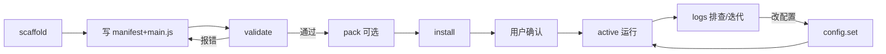

# ClipForge 插件开发指南(agent-plugin-runtime)

> 状态:随提案 draft(未实施)。权威契约 = [design.md](../design.md) + [specs/](../specs/);本文是面向插件开发者(Agent / 人)的操作视图,冲突以 design.md 为准。
> API 逐项签名见 [API_REFERENCE.md](API_REFERENCE.md);整体架构与功能预演见 [architecture.html](architecture.html)。

## 0. 三十秒理解

- 一个插件 = 一个包 = 一条生命周期。你在 `activate(ctx, config)` 里注册一切,宿主停用时 dispose 一并回收,无手动 unregister。
- **你能看见什么由 manifest 决定**:声明了的能力对象才存在;未声明的在 `ctx` 上根本没有(不是被拒绝,是不存在)。
- 与宿主的一切数据交换走 **JSON 边界**:值是副本;超时/超限只让本次调用失败,插件间互不拖垮。
- 没有 fetch、定时器、文件系统、require 宿主模块。纯事件 + 工具调用驱动。

## 1. 心智模型:cordis 三件套如何变成你的 ctx

宿主内部用 cordis-rs 管插件,组合方式(你不用写,但理解有助排障):

| cordis 概念 | 宿主用法 | 插件侧所见 |
|---|---|---|
| **Fiber** | `Context::spawn(PreparedPlugin)` 准入你的实例;六态状态机 Loading→Active/Pending→Unloading→Disposed;apply 失败收敛 Failed(非终态) | `activate` / `deactivate` 两个钩子;失败停靠不自动重试 |
| **Service** | 宿主能力发布为 typed Service(`Context::provide`);插件经 InjectSpec 声明依赖,未就绪时 Fiber 收敛 Pending 等待,服务发布后自动回 Active | `ctx.clipf.search` 等属性——manifest 声明才有,声明与使用分离 |
| **Event** | 域层 DB 提交成功后 emit typed Event | `ctx.on("capture.finished", handler)`——仅已声明事件名生效 |

组合链条:spawn → `apply()` 里插件拿 Context 注册(on/register)→ dispose 时世代清理按 LIFO 回收全部注册项。**你注册的一切都归本次 apply 世代所有**,这就是"dispose 确定性回收"的来源。

## 2. 开发循环(七步)



1. **scaffold**:`powerpack.scaffold({ id, name, capabilities })` → 返回骨架 + **当前已发布能力/事件清单**(能力面唯一事实,不猜接口)。
2. **写码**:manifest + main.js(§4)。
3. **validate**:`powerpack.validate(dir)` → schema 校验 + dry-run activate + slots 对账 + realpath 检查。**不改任何生效状态,不需重启宿主**;dry-run 报的错就是运行时会报的错。
4. **修复**:按错误码 + `data.pointer` + `data.stack` 自闭环(§5),再 validate。
5. **pack(可选,发布用)**:`powerpack.pack({ id })` → `<id>-<version>.clipforge-plugin.tar.gz` + blake3 校验和。
6. **install**:`powerpack.install({ 包, checksum })` → 用户交互确认 capabilities(含分级授权)→ 原子落盘 → spawn。**拒绝则仅存暂存区,不生效**。
7. **运维**:`powerpack.logs` 排查、`powerpack.config.set` 改配置(重启生效)、`powerpack.list` 看状态。

## 3. 包结构与 manifest

```
<id>/
├── power-pack.json      # manifest(合同,安装时审查)
├── main.js              # 入口(ESM,两个 named export)
├── templates/*.md       # 可选,提示词模板
└── README.md            # 可选
```

manifest 关键字段(全表见 [API_REFERENCE.md §8](API_REFERENCE.md)):

| 字段 | 必填 | 说明 |
|---|---|---|
| `api` | 是 | 契约版本,当前 `1` |
| `id` | 是 | 反向 DNS,全局唯一,装包即占位 |
| `capabilities.clipf` | 否 | ⊆ 已发布能力清单,越界 = validate 拒绝 |
| `capabilities.events` | 否 | ⊆ 已发布事件清单 |
| `slots` | 否 | 将注册什么的声明索引(runtime 注册必须 ⊆ 它);纯事件插件可为空 |
| `config` | 否 | JSON Schema 子集,顶层属性必须带 default |
| `memoryLimit` | 否 | 默认 8MB,上限 32MB |

## 4. 编写 main.js

```js
// main.js —— 全部代码(规则自动打标示例)
export function activate(ctx, config) {
  const rules = config.rules.map((r) => ({ re: new RegExp(r.pattern), tag: r.tag }));

  ctx.on("capture.finished", async (e) => {
    if (e.bytes < config.minLength) return;  // 信封带 bytes,先探大小再读
    const { content, contentLength } = await ctx.clipf.read({ id: e.clipId });  // 默认截断 256KB
    if (contentLength < config.minLength) return;
    const tags = rules.filter((r) => r.re.test(content)).map((r) => r.tag);
    if (tags.length) {
      await ctx.clipf.tag.write({ id: e.clipId, tags, source: "auto-tag-rules" });
    }
  });
}

export async function deactivate(ctx) {
  // 可选。v1 能力集下通常为空:世代清理已覆盖全部 ctx 注册项
}
```

规则:

| 位置 | 同步/异步 | 纪律 |
|---|---|---|
| `activate` / `ctx.register.*` / `ctx.on` | 同步 | **只做注册**;里面调 `ctx.clipf.*` 报 `PLUGIN_ACTIVATE_READONLY` |
| 能力调用 `ctx.clipf.*` | async Promise | 只能在事件回调/工具 handler 内;计入 toolTimeout 预算 |
| 工具 `handler` | async | 入参已过 schema 校验;超 toolTimeoutMs 本次报错,Runtime 不销毁 |
| 事件回调 | 可同步可 async | 超 eventBudgetMs(100ms)降级丢弃——回调里只做必要工作 |

## 5. 调试与排障

**没有源码级调试器**。三板斧 = 错误码 + 栈 + 日志:

- 错误码:`PLUGIN_<域>_<原因>` 稳定前缀(全表见 [API_REFERENCE.md §6](API_REFERENCE.md));`data.pointer` 给 manifest 位置,`data.stack` 给 JS 异常帧。
- `console.*` 由宿主注入,等同 `ctx.log.*`,限流 100 行/分。
- `Error.stackTraceLimit` / `prepareStackTrace` 可用。

症状 → 查法:

| 症状 | 第一步 | 看什么 |
|---|---|---|
| 装完没生效 | `powerpack.logs({pluginId, level:"error"})` | `PLUGIN_APPLY_FAILED`(看 stack)/ `PLUGIN_MEMORY_EXCEEDED` |
| 工具调不到 | `tools/list` 查 `plugin.<包名>.*` | 命名空间消失 = 被禁用/failed(事件预算型 degraded 工具仍可调) |
| 事件没触发动作 | logs 查事件分发行 | `dropped` 计数 > 0 = 回调超预算或队列满 |
| 配置改了没变化 | logs 查 `config-change` 行 | `PLUGIN_CONFIG_INVALID` 拒写,或插件未重启 |
| 越用内存越大 | `powerpack.list` 看 memoryUsage | 逼近 memoryLimit = 泄漏信号 |

## 6. 发布与安装

- **发布物** = tar.gz + blake3 校验和;install 重算比对,不符拒绝(`PLUGIN_CHECKSUM_MISMATCH`)。
- **来源 v1 两种**:Agent 本地生成 / 用户手动目录;无中心 registry。
- **升级** = dispose 旧实例 → 新包 spawn(全新 Runtime,状态归零);降级允许(记 warn)。
- **卸载** = 删包目录;config.json 保留(重装沿用),`--purge` 才删。

## 7. 内存与预算红线

| 项 | 默认 | 上限 | 超限行为 |
|---|---|---|---|
| memoryLimit | 8MB | 32MB | Runtime 强制回收,插件停 failed(重新启用恢复) |
| toolTimeoutMs | 5000 | 30000 | 本次调用报错 |
| eventBudgetMs | 100 | 100(不可调高) | 丢弃降级(工具仍可调) |
| 事件载荷 | — | 64KB | 拒投递 |
| 工具入参 / 返回 | — | 256KB / 1MB | 本次调用报错 |
| 能力返回(read) | 256KB(默认截断) | min(memoryLimit/4, 2MB)(opt-in) | 本次调用报错,提示 maxLen 分页 |
| 启用插件数 / 聚合内存 | — | 16 个 / 128MB | install/enable 拒绝 |
| ctx.log | 100 行/分 | 突发 1000 | 溢出丢弃+计数 |

写码纪律:回调里别做重计算——单事件 JS 计算应在 100ms 量级内(QuickJS 比原生 JS 慢约一个数量级);批处理拆成多次工具调用(吃 toolTimeout 预算)或 read 分页;计算密集/延迟敏感场景不适合插件化(走宿主内置)。大结果分页;别攒全局缓存不放;深层递归有 256KB 栈上限。

## 8. 边界与 FAQ

- **如何申报新能力/新事件**:走提案流程(design §5 additive),`api` 保持 1;宿主支持 N 与 N-1。
- **能拦截/包裹宿主工具吗**:不能。插件是沙箱不可信代码,无拦截权(与 pi 受信扩展的信任模型差异,见 design §20)。
- **能引第三方 npm 包吗**:v1 无打包器,QuickJS 原生 ESM;纯 JS 依赖放包目录随包分发,体积计 10MB 上限。
- **多个插件能通信吗**:v1 不能(无插件间通道);经宿主域层数据间接协作。
